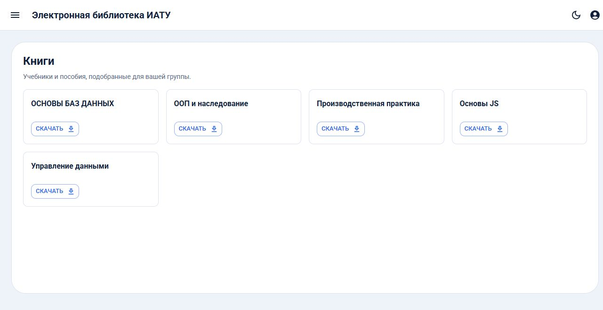
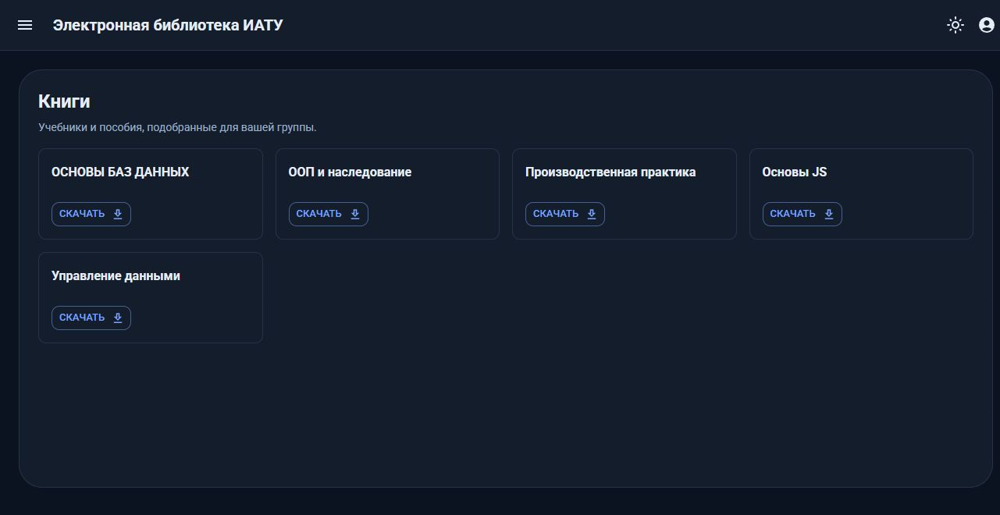
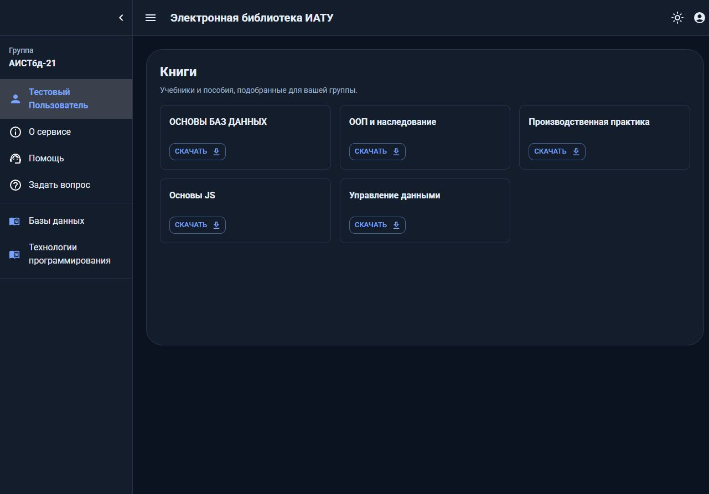

# Библиотека для вуза

Книги распределены по дисциплинам, а дисциплины — по группам.
Каждому пользователю присваивается его группа, поэтому он видит только книги, которые нужны ему в процессе обучения.

Дорожная карта работы: [TODO.md](TODO.md).

## Скриншоты

Список книг группы — светлая тема:



Та же страница в тёмной теме:



Навигация по разделам и дисциплинам:



## Интерфейс

- Светлая и тёмная темы. Переключатель — в шапке; на страницах входа и регистрации — в правом верхнем углу.
- Выбор запоминается в `localStorage` (`libraryiatu.color-mode`). Если выбора ещё нет,
  используется системная настройка `prefers-color-scheme`, и её изменения отслеживаются.
- Тема применяется до первой отрисовки (inline-скрипт в `resources/views/app.blade.php`),
  поэтому при загрузке нет вспышки светлого фона.
- Палитра, типографика и общие стили компонентов собраны в
  `resources/js/Application/theme.tsx`; страницы используют общий контейнер `PageSurface`,
  а гостевые формы (вход, регистрация, восстановление пароля) — карточку `AuthCard`.

## Стек

- PHP 8.5, Laravel 13
- SQLite (файл `database/database.sqlite`)
- Laravel Fortify + Sanctum (аутентификация SPA)
- React 19 + TypeScript + Material UI 9 (`@mui/material`)
- React Router 7 (`createBrowserRouter`, code splitting страниц)
- Vite 7
- PHPUnit 12, Laravel Pint

## Запуск

```bash
composer install
npm install

copy .env.example .env
php artisan key:generate

# SQLite-база создаётся автоматически при миграции
php artisan migrate --seed

npm run dev        # или npm run build для production-сборки
php artisan serve
```

Приложение откроется по адресу `http://localhost:8000`.

> Для dev-режима нужны одновременно `npm run dev` и `php artisan serve`.

Письма (в том числе со ссылками восстановления пароля) при `MAIL_MAILER=log`
пишутся в `storage/logs/laravel.log` — там же можно взять готовую ссылку для проверки.
Тексты писем переведены через `resources/lang/ru.json`.
Для продакшена нужен реальный SMTP: `MAIL_MAILER=smtp` + `MAIL_HOST`/`MAIL_PORT`/`MAIL_USERNAME`/`MAIL_PASSWORD`.

## Локальные проверки

CI на GitHub Actions отключён: все проверки запускаются **локально перед каждым пушем в main**.
Хук `pre-push` делает это автоматически:

```bash
git config core.hooksPath .githooks   # один раз после клонирования
```

Набор перед пушем: `composer lint` (Pint + PHPStan, уровень 6), `php artisan test`,
`npm run lint`, `npm run typecheck`, `npm run build`.

Вручную то же самое:

```bash
npm run build          # production-сборка фронтенда
npm run typecheck      # проверка TypeScript
npm run lint           # ESLint (JS/TS)
php artisan test       # тесты
composer lint          # Pint (стиль PHP) + PHPStan (статический анализ)
vendor/bin/pint        # авто-форматирование PHP
php artisan route:list
```

## API

Все изменения данных выполняются через `POST`, `PUT` и `DELETE`; GET-запросы ничего не меняют.
Аутентификация — сессионная (Sanctum), поэтому запросы из SPA отправляются с cookie и CSRF-токеном.

| Метод | URL | Назначение |
|-------|-----|------------|
| `GET` | `/api/session` | Проверка статуса сессии |
| `GET` | `/api/group-names` | Список групп для формы регистрации |
| `POST` | `/api/login` | Вход |
| `POST` | `/api/register` | Регистрация (требует `group_name_id`) |
| `POST` | `/api/logout` | Выход |
| `POST` | `/api/forgot-password` | Запрос ссылки для восстановления пароля (6/мин, ответ всегда нейтральный) |
| `POST` | `/api/reset-password` | Установка нового пароля по токену (6/мин) |
| `GET` | `/api/user` | Имя текущего пользователя |
| `GET` | `/api/groups` | Группа пользователя |
| `GET` | `/api/disciplines` | Дисциплины группы (`id`, `disciplinename`) |
| `GET` | `/api/disciplines/{id}/books` | Книги дисциплины, доступные группе (проверка группы) |
| `GET` | `/api/books` | Книги группы |
| `GET` | `/api/books/{id}/download` | Файл книги (проверка группы) или редирект на внешнюю ссылку |
| `GET` | `/api/books/{id}/cover` | Обложка книги (inline-картинка, проверка группы) |
| `GET` | `/api/questions` | Вопросы пользователя |
| `POST` | `/api/questions` | Создать вопрос |
| `PUT` | `/api/questions/{id}` | Обновить свой вопрос |
| `DELETE` | `/api/questions/{id}` | Удалить свой вопрос |

## Файлы книг

Книга может храниться двумя способами (Filament требует хотя бы один из них):

- **Файл на сервере** — приватный диск `local`, каталог `storage/app/private/books`.
  Он намеренно **не** публикуется через `php artisan storage:link`: постоянного URL у файлов
  нет, студент получает их только через `GET /api/books/{id}/download`, где проверяется
  учебная группа пользователя. (В панели Filament для предпросмотра используются короткие
  подписанные ссылки Laravel — они не передаются студентам.) Имя файла при скачивании — название книги
  (`App\Book::downloadFileName()`), а не хеш из хранилища.
- **Внешняя ссылка** (`books.link`) — так живут книги, импортированные из дампа;
  контроллер делает `302` редирект на неё.

Ответ `/api/books` не отдаёт внутренний путь (`file_path`), только флаг `has_file` —
по нему SPA решает, вести ли «Скачать» на наш эндпоинт или сразу на внешнюю ссылку.

Файл удаляется с диска вместе с книгой и при замене файла в форме (см. `Book::booted()`),
а при удалении книги сначала снимаются связи из `group_books` и `discipline_books`.

Ограничения загрузки: 50 МБ и типы PDF/EPUB/DOC(X)/RTF/TXT/FB2/DJVU. На хостинге
нужно поднять `upload_max_filesize`, `post_max_size` (PHP) и `client_max_body_size` (nginx).

## Обложки книг

Необязательная обложка задаётся в Filament (JPG/PNG/WEBP до 10 МБ) и живёт рядом с файлом
на том же приватном диске — каталог `storage/app/private/covers`. Прямого URL у неё нет:
`GET /api/books/{id}/cover` отдаёт inline-картинку с той же проверкой группы, что и файл книги,
а карточка книги в SPA показывает её или заглушку-иконку, когда обложки нет
(флаг `has_cover` в ответе `/api/books`). Обложка — оформление, а не контент:
книга по-прежнему требует файл или внешнюю ссылку. Удаляется вместе с книгой и при замене.

## Импорт данных

Демо-данные создаются сидером по умолчанию. Чтобы импортировать реальные данные из
MySQL-дампа `libraryiatu.sql`, выполните:

```bash
php artisan migrate:fresh --seed
```

`LibraryImportSeeder` автоматически разбирает дамп и наполняет таблицы `users`,
`directions`, `group_names`, `types`, `disciplines`, `books`, `groups`,
`group_books`, `group_disciplines` и `questions`.

Дамп содержит реальные имена и email, поэтому `libraryiatu.sql` добавлен в `.gitignore`
и хранится только локально. Если файла нет, сидер создаёт демонстрационные данные.
В репозиторий также не попадают SQLite-база, `.env` и каталог `public/build`.

## Администрирование

Laravel Nova удалена. Админ-панель — **Filament v5** (`/admin`):

- Адрес: `http://localhost:8000/admin` (только для пользователей с `is_admin = 1`).
- Разделы: Книги (типы, направления), Группы (названия групп, дисциплины, привязка книг к группе,
  дисциплины к группе пользователя), Поддержка (просмотр вопросов студентов), Пользователи (назначение роли).
- Выдать права администратора: `php artisan app:make-admin email@example.com`
- Сброс пароля администратора — страница `/admin/password-reset/request` (письмо формирует
  Filament и ведёт на панель, а не на SPA); студенты восстанавливают пароль через SPA.
- Доступ жёстко ограничен: `User::canAccessPanel()` возвращает `is_admin`;
  проверено тестами (`AdminPanelTest`): обычный пользователь получает 403.

## Задача

Электронная библиотека — система, предназначенная для обеспечения учебного процесса необходимой
литературой (информацией), а также оказания содействия повышению уровня развития студентов и
преподавателей вуза. Пользователь взаимодействует с системой через браузер.

## Лицензия

MIT — полный текст в [LICENSE](LICENSE).

Свободный код относится только к коду: дамп `libraryiatu.sql` (реальные имена, email
и группы студентов) в репозиторий не попадает и лицензией не покрывается —
распространять его нельзя.
