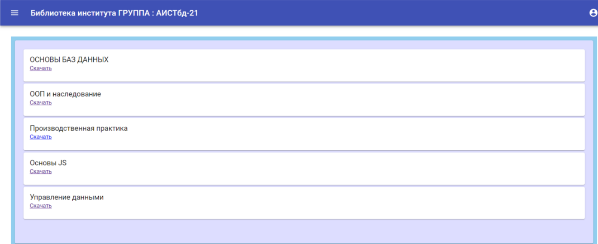

# Библиотека для вуза

Книги распределены по дисциплинам, а дисциплины — по группам.
Каждому пользователю присваивается его группа, поэтому он видит только книги, которые нужны ему в процессе обучения.

## Скриншоты

Список книг группы:



Навигация по разделам и дисциплинам:


## Стек

- PHP 8.5, Laravel 13
- SQLite (файл `database/database.sqlite`)
- Laravel Fortify + Sanctum (аутентификация SPA)
- React 17 + TypeScript + Material UI 4
- Vite 7
- PHPUnit 12, Laravel Pint

## Запуск

```bash
composer install
npm install

copy .env.example .env
php artisan key:generate

# SQLite-база создаётся автоматически при миграции
php artisan migrate --seed

npm run dev        # или npm run build для production-сборки
php artisan serve
```

Приложение откроется по адресу `http://localhost:8000`.

> Для dev-режима нужны одновременно `npm run dev` и `php artisan serve`.

## Полезные команды

```bash
npm run build          # production-сборка фронтенда
npm run typecheck      # проверка TypeScript
php artisan test       # тесты
vendor/bin/pint        # форматирование PHP
vendor/bin/pint --test # проверка стиля без изменений
php artisan route:list
```

## API

Все изменения данных выполняются через `POST`, `PUT` и `DELETE`; GET-запросы ничего не меняют.
Аутентификация — сессионная (Sanctum), поэтому запросы из SPA отправляются с cookie и CSRF-токеном.

| Метод | URL | Назначение |
|-------|-----|------------|
| `GET` | `/api/session` | Проверка статуса сессии |
| `POST` | `/api/login` | Вход |
| `POST` | `/api/register` | Регистрация |
| `POST` | `/api/logout` | Выход |
| `GET` | `/api/user` | Имя текущего пользователя |
| `GET` | `/api/groups` | Группа пользователя |
| `GET` | `/api/disciplines` | Дисциплины группы |
| `GET` | `/api/books` | Книги группы |
| `GET` | `/api/questions` | Вопросы пользователя |
| `POST` | `/api/questions` | Создать вопрос |
| `PUT` | `/api/questions/{id}` | Обновить свой вопрос |
| `DELETE` | `/api/questions/{id}` | Удалить свой вопрос |

## Импорт данных

Демо-данные создаются сидером по умолчанию. Чтобы импортировать реальные данные из
MySQL-дампа `libraryiatu.sql`, выполните:

```bash
php artisan migrate:fresh --seed
```

`LibraryImportSeeder` автоматически разбирает дамп и наполняет таблицы `users`,
`directions`, `group_names`, `types`, `disciplines`, `books`, `groups`,
`group_books`, `group_disciplines` и `questions`.

Дамп содержит реальные имена и email, поэтому `libraryiatu.sql` добавлен в `.gitignore`
и хранится только локально. Если файла нет, сидер создаёт демонстрационные данные.
В репозиторий также не попадают SQLite-база, `.env` и каталог `public/build`.

## Администрирование

Laravel Nova удалена. Сейчас книги, группы и дисциплины управляются через импорт дампа
или напрямую через БД. Для полноценной админки планируется Filament.

## Задача

Электронная библиотека — система, предназначенная для обеспечения учебного процесса необходимой
литературой (информацией), а также оказания содействия повышению уровня развития студентов и
преподавателей вуза. Пользователь взаимодействует с системой через браузер.
